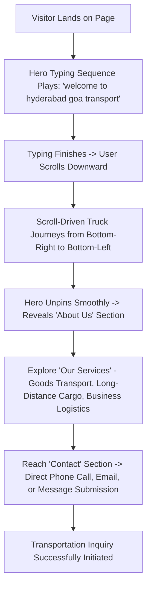

# Product Brief: Hyderabad Goa Transport (HGT)

## 1. Executive Summary & Purpose
Hyderabad Goa Transport (HGT) is a specialized, dedicated inter-state cargo and freight transportation service connecting Hyderabad, Telangana with Goa and key industrial/commercial corridors along the route.

The website serves as the primary digital presence and brand experience for the company. Rather than looking like a generic, cluttered logistics directory, the website establishes instant credibility, quiet luxury, and modern professionalism through a minimalist, editorial-grade visual design and choreographed motion engineering.

---

## 2. Target Audience & Personas
1. **Commercial Freight Managers & Procurement Leads**:
   - Needs: Dependable schedules, careful cargo handling, transparent communication.
   - Tech familiarity: Moderate to high (browsing on mobile and desktop).
   - Priority: Rapid credibility check and instant access to contact/inquiry.
2. **Business Owners & Distributors (B2B)**:
   - Needs: Regular consignments between Telangana/Andhra and Goa coastal markets.
   - Priority: Understanding core transport capabilities and initiating direct quotation dialogue.
3. **Individual Consignors**:
   - Needs: Safe moving of high-value goods, vehicles, or personal cargo.
   - Priority: Approachable, trustworthy, non-intimidating interface.

---

## 3. Core Value Proposition
- **Precision & Reliability**: Dedicated route specialization ensuring predictable transit times.
- **Modern Minimalist Presentation**: A clean, intentional aesthetic that sets HGT apart from standard chaotic logistics portals.
- **Seamless Accessibility**: Frictionless inquiry channels (direct phone, email, and one-click WhatsApp inquiry).

---

## 4. Key User Journeys

### Detailed Journey Steps:
1. **Initial Impression & Brand Immersion (Hero)**:
   - Pure white canvas with elegant editorial typography.
   - The lowercase message `"welcome to hyderabad goa transport"` types letter-by-letter over 3–3.5s with an editorial blinking cursor.
   - The truck rests quietly on the road at the bottom-right.
2. **Scroll-Driven Motion Experience**:
   - As the visitor initiates scroll, the hero pins.
   - The small cargo truck (matching reference with red cab, dark chassis, detailed wheels) rolls smoothly right-to-left.
   - The wheels rotate in exact synchronization with travel distance.
   - Scrolling up reverses the journey with matching wheel rotation.
3. **Credibility & Capabilities**:
   - Natural unpinning transitions into the "Who We Are" narrative.
   - Three key service pillars provide structured clarity.
4. **Action & Conversion**:
   - Clear, elegant contact details and a lightweight message form enable direct inquiries.

---

## 5. Scope & Functional Boundaries
- **Included**:
  - Interactive single-page responsive application.
  - Character-by-character typing animation with blinking cursor cleanup.
  - Synchronized SVG truck rolling animation linked to GSAP ScrollTrigger.
  - Editorial typography hierarchy using Google Web Fonts (`Bodoni Moda` and `Plus Jakarta Sans`).
  - Responsive header with anchor navigation.
  - About Us, Services, and Contact sections.
  - Full mobile touch responsiveness and `prefers-reduced-motion` compliance.
- **Excluded (Out of Scope)**:
  - Heavy backend database or authentication.
  - GPS live shipment tracking API (placeholders provided for inquiry).
  - External paid analytics or payment gateways.

---

## 6. Official Contact Channels & Primary Hub
- **Dispatch Email**: `Hyderabadgoa1977@gmail.com`
- **Booking & Dispatch Phone**: `+91 98493 02205`
- **Primary Hyderabad Terminal**: Gaganpahad, Shamshabad, Hyderabad, Telangana

